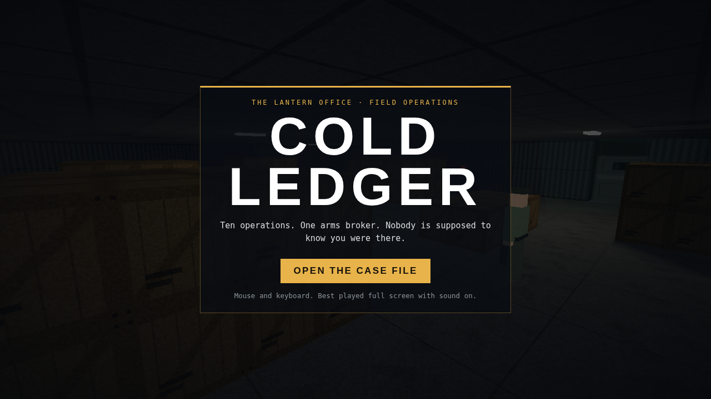
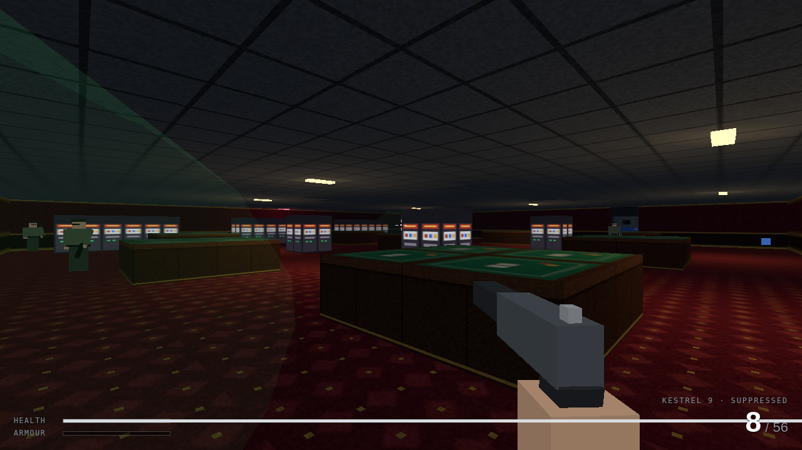
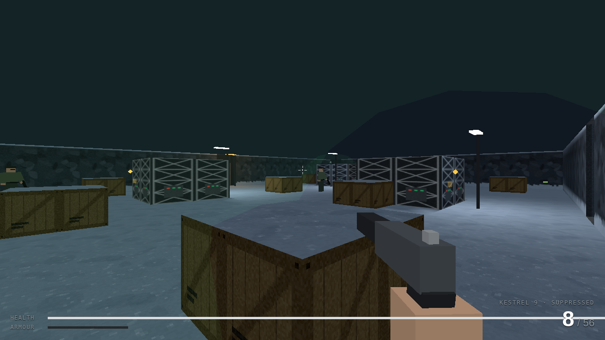
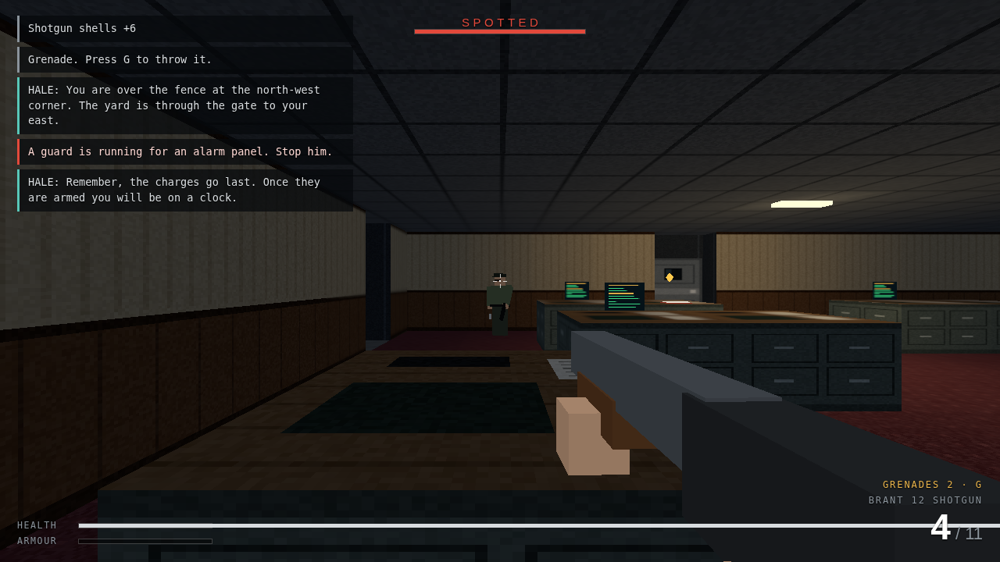
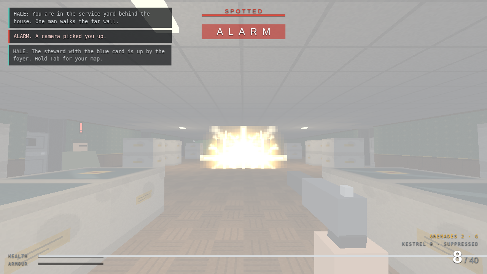
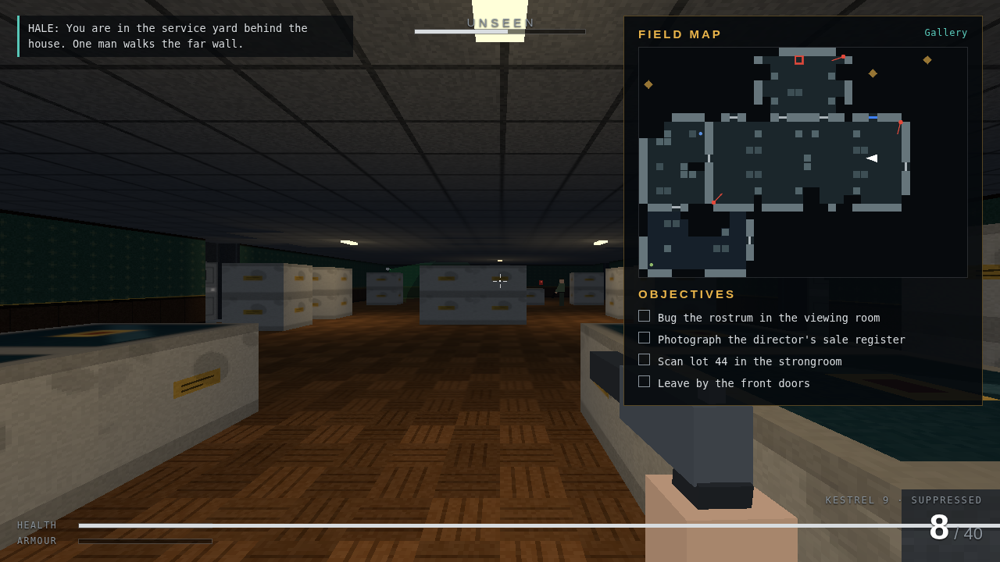
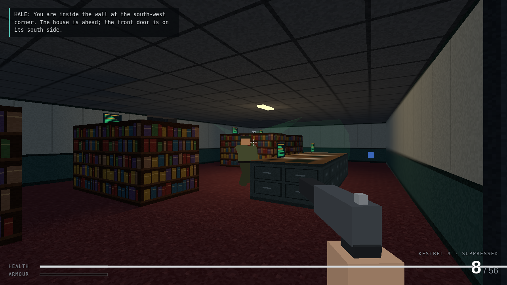
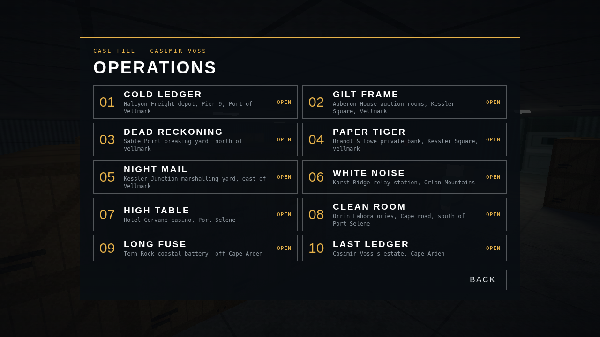
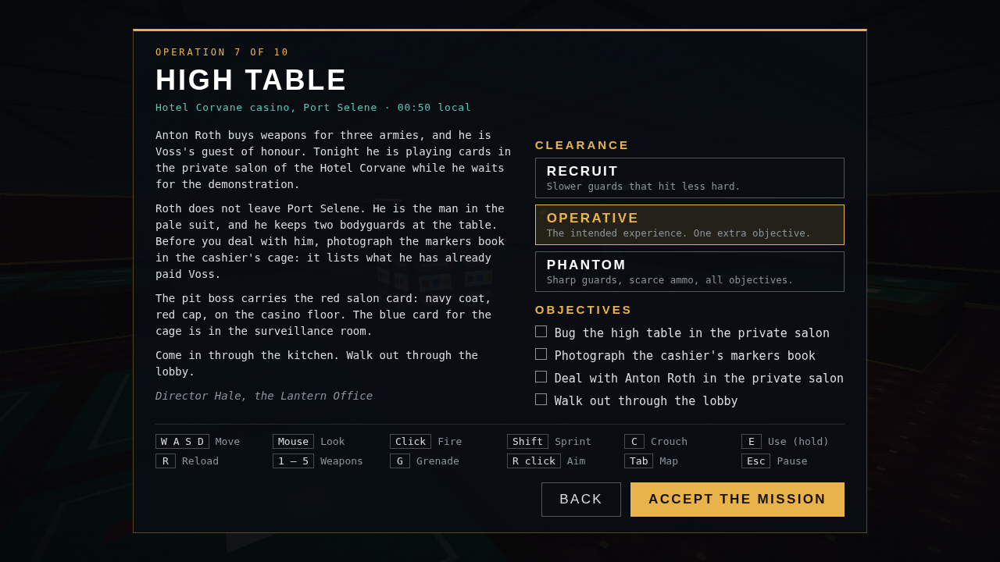

# Cold Ledger

An original first-person spy thriller that runs in the browser. Ten operations, one arms broker, and nobody is supposed to know you were there.



You are a field agent for the Lantern Office, working through the case file on the arms broker Casimir Voss. Each operation drops you into a guarded building with a short list of objectives: photograph a register, plant a bug, copy a drive, deal with a target, get out. You can go quietly or loudly, and the debrief tells you which one you managed.

The game is written in plain JavaScript on top of [three.js](https://threejs.org). There is no build step and nothing to install. Textures and sound effects are generated in code, so the repository contains no art or audio files.

## Screenshots

| | |
|---|---|
|  |  |
| Operation 7, High Table: the casino floor | Operation 6, White Noise: the relay station |
|  |  |
| Spotted, with the shotgun out | A grenade in the auction gallery |
|  |  |
| The field map fills in as you explore | Operation 10, Last Ledger: the library |
|  |  |
| The case file | A briefing, with clearance levels |

## Play it

You need [Node.js](https://nodejs.org) 18 or newer and a desktop browser with WebGL. The game needs a mouse and keyboard.

```sh
git clone https://github.com/grizzlypeaksoftware/spy-game.git
cd spy-game
npm start
```

Then open <http://localhost:5173>. To use a different port, run `PORT=8080 npm start`.

`npm start` runs a small static file server and has no dependencies, so there is no `npm install` step. Any other static file server pointed at this folder works too. Opening `index.html` straight from disk does not, because browsers block JavaScript modules on `file://` pages.

### Hosting it on GitHub Pages

The game is a static site, so GitHub Pages can serve it as it is. In the repository settings, open **Pages**, choose **Deploy from a branch**, and pick the `main` branch and the `/ (root)` folder.

## Controls

| Key | Action |
|---|---|
| W A S D | Move |
| Mouse | Look |
| Left click | Fire |
| Right click | Aim (marksman rifle) |
| Shift | Sprint |
| C | Crouch |
| E (hold) | Use |
| R | Reload |
| 1 to 5 | Weapons (1 is your fists) |
| G | Throw a grenade |
| Tab (hold) | Field map and objectives |
| Esc | Pause |

## How it plays

- **Stealth.** Guards see and hear. Crouching is quiet, sprinting and unsuppressed gunfire are not. A guard who has not noticed you goes down silently to one blow of your fists (weapon 1).
- **Alarms.** A guard who spots you may run for an alarm panel, and cameras raise the alarm themselves. An alarm brings reinforcements, and in some operations it starts a clock.
- **Keycards.** Blue and red doors need the matching card. The briefing says who is carrying it or where it is kept.
- **Weapons.** You start with a suppressed pistol. A submachine gun, a shotgun, a marksman rifle and grenades turn up in some operations. Weapons do not carry over between operations.
- **Clearance.** Recruit, Operative and Phantom. Higher clearance means sharper guards, less ammunition and more objectives.
- **Ratings.** Each completed operation is rated Ghost, Professional or Blunt Instrument, depending on how much noise you made.

Finishing an operation opens the next one. Progress is saved in the browser's local storage. Adding `?unlock` to the address opens all ten.

## The operations

| # | Codename | Location |
|---|---|---|
| 01 | Cold Ledger | Halcyon Freight depot, Port of Vellmark |
| 02 | Gilt Frame | Auberon House auction rooms, Vellmark |
| 03 | Dead Reckoning | Sable Point breaking yard |
| 04 | Paper Tiger | Brandt & Lowe private bank, Vellmark |
| 05 | Night Mail | Kessler Junction marshalling yard |
| 06 | White Noise | Karst Ridge relay station, Orlan Mountains |
| 07 | High Table | Hotel Corvane casino, Port Selene |
| 08 | Clean Room | Orrin Laboratories, south of Port Selene |
| 09 | Long Fuse | Tern Rock coastal battery, off Cape Arden |
| 10 | Last Ledger | Casimir Voss's estate, Cape Arden |

## Project layout

```
index.html        Page, menus and HUD markup
css/style.css     Menu and HUD styling
server.js         Static file server used by `npm start`
js/main.js        Menus, briefing and debrief screens, saved progress
js/game.js        Game loop, objectives, alarms, clocks, pickups, grenades
js/player.js      Movement, weapons and view models
js/enemy.js       Guard behaviour: patrol, sight, hearing, combat
js/world.js       Builds the 3D level from a mission's map
js/grid.js        Tile grid, collision and line of sight
js/map.js         The field map
js/hud.js         Heads-up display
js/textures.js    Textures drawn in code
js/audio.js       Sound effects synthesised in code
js/mission.js     Mission list and clearance levels
js/missions/      One file per operation
vendor/           three.js (MIT licence)
```

### Adding an operation

Each operation is one data file in [js/missions/](js/missions/). The level is a 40 by 28 grid of characters, with a legend at the top of every mission file:

```
#  wall            .  floor
c  low cover       C  tall block
D  door            1  blue keycard door     2  red keycard door
P  player start    X  extraction point
```

The rest of the file lists zones (floor, wall and prop styles for each room), lights, guard patrols, cameras, alarm panels, pickups, objectives and radio lines. Copy an existing mission, edit it, and add it to the `MISSIONS` list in [js/mission.js](js/mission.js).

## Licence

The game is released under the [MIT Licence](LICENSE). The bundled copy of three.js is also MIT licensed; see [vendor/LICENSE-three.txt](vendor/LICENSE-three.txt).

Cold Ledger is an original work. Its story, characters, places and levels are fictional and are not based on any existing game or film.
